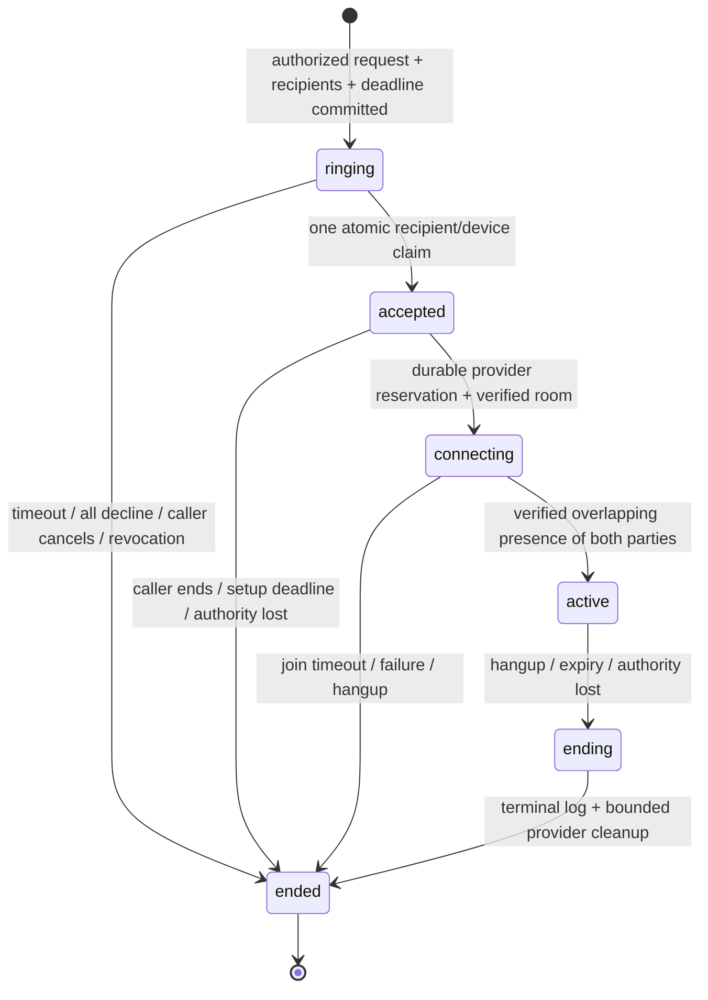

# Ticket calling — owner approval design

Date: 29 October 2026. Status: PROPOSED; no feature implementation or rollout approved by this document. Foundation: [draft PR #76](https://github.com/UplineTonyuo/wolf-forge-platform/pull/76), branch `codex/woad-live-calls-20261026`, original head `4d4b890`. Merge preparation and environment evidence are in [report.md](report.md).

## Scope and approval gates

Private, two-person voice/video calls inside Ticket conversations, in both directions. No native application, phone-number dialing, recording, transcription, screen sharing, group calls or observer joins. Team supervision does not grant media access. Keep the existing Ticket/linked Order authority and published-module boundaries.

The owner's requested defaults are preserved: client calls the assigned team member, or all authorized team members when unassigned; team calls the Ticket's owning client user; first acceptance wins; a 40-second ring window ends in a missed call and bell notification. Business hours is an optional setting awaiting an owner decision. Call logs and monthly owner reporting must reconcile with Daily.

Two requirement qualifications need owner acceptance before implementation:

1. An active PWA can loop a ringtone and show Accept/Decline. A minimized Windows PWA may continue doing so while its document runs. Browsers can freeze/discard hidden pages, and phones suspend background apps. Neither a service worker nor Web Push can guarantee continuous background ringing or a native incoming-call screen. Use generic Web Push for closed **and potentially suspended/minimized** apps, plus in-app ringing whenever executing. OS Focus, offline state, force-stop and permissions can delay or prevent alerts. This follows the [browser page lifecycle](https://developer.chrome.com/docs/web-platform/page-lifecycle-api), not an application guarantee.
2. Tapping a timely notification opens directly to the authorized call screen. It cannot silently accept, bypass login, or switch on media. A saved acceptance action can resume after login only after fresh authorization and explicit user confirmation. Expired calls open their missed/ended state, never a replacement room.

PR #76 stays draft pending migration ordering, fresh validation and human media/device acceptance. The `wolf-forge-platform-pwa` Daily pilot is superseded and must not be revived.

## What already exists

| Capability | Repository evidence | Limit relevant to this design |
| --- | --- | --- |
| Private Daily rooms/tokens, two participants, fixed 15-minute expiry, media feature restrictions | `src/lib/daily/calls.ts`, `src/services/ticket-call-service.ts`, `src/app/api/ticket-calls/route.ts` | Explicit Join and discovery in an open Ticket; no invitation or selected callee |
| Durable room reservation and provider throttles | `supabase/migrations/20261026123450_ticket_live_calls.sql`, `private.ticket_calls`, `app_ticket_call` | `reserved/ready/ended`; participants array; no answered timestamps or reliable usage log |
| Client/team call controls | `src/components/tickets/ticket-call-controls.tsx` | Five-second status polling skips hidden documents |
| Conversation updates | `src/app/api/ticket-live/route.ts`, `src/components/tickets/use-ticket-live-sync.ts` | Authenticated polling; hidden/offline documents stop scheduling. No existing Supabase call-signalling channel found |
| Audio unlock/chime | `src/lib/notifications/browser-notification-feedback.ts` | Reuse audio activation and preference patterns; a short chime is not a looping ringtone |
| Web Push worker | `public/push-sw.js` | Payload-free generic update; authenticated status fetch; click focuses client workspace or opens `/launch`; no call route |
| Device opt-in and session binding | `src/components/account/profile/client-push-notifications.tsx`, `src/app/actions/push.ts`, `src/lib/notifications/push-server.ts`, `src/domain/notifications/push.ts`, `src/app/api/push/status/route.ts` | Client context only; internal team enrollment is new work |
| Subscriptions/configuration/delivery ledger | `20261020110724_studio_web_push_notifications.sql`, `20261022151319_production_web_push.sql` | Private tables `push_subscriptions`, `studio_push_configuration`, `push_deliveries`; encrypted Vault VAPID/dispatch credentials; current delivery rows require a bell notification |
| Existing sends | `supabase/functions/studio-web-push/index.ts`, `handler.ts`; migration helpers `enqueue_studio_push`/`wake_studio_push` | Notification trigger, immediate wake plus minute recovery job; client-only generic activity, TTL 300 seconds. Provider acceptance does not prove device display |

These are source capabilities, not proof of live production configuration. This task did not query production or send push.

## Server-authoritative state and protocol

Postgres owns invitation state, recipient selection, acceptance, deadlines and terminal outcome. Daily owns evidence of actual media participation. Browser clocks, tab presence and SDK events are observations; they cannot settle the durable log or elect a winner. All commands are bounded same-origin POSTs using the HttpOnly session and verified actor; all RPCs independently recheck authorization. Reads are private/no-store.

Keep room lifecycle separate from invitation lifecycle. Extend the foundation rather than treat `ready` as answered. An invitation is created before any room; defer room creation until acceptance to avoid provisioning rooms for unanswered calls.

`requested_at` is the call attempt start; `ring_started_at` is the invitation commit time and starts the 40-second window, regardless of delivery delay. `accepted_at` records the winner. `answered_at` is the first verified two-party media overlap; `media_started_at` may precede it if one participant waits alone. `ended_at` is the effective termination time; `finalized_at` records later reconciliation. Store UTC server timestamps. Proposed connecting deadline: 45 seconds after acceptance, capped by fixed room expiry. Never reset ring/room expiry on retry or reload.

| Terminal outcome | Condition | Separate reason/examples |
| --- | --- | --- |
| `answered` | Verified two-party connection happened before termination | normal hangup, disconnect, maximum duration, revocation after answer |
| `declined` | Sole recipient declines, or every eligible fallback recipient declines | explicit recipient refusal; one fallback decline does not terminate other invitations |
| `missed` | Ring deadline passes with no acceptance and caller did not cancel | offline/no delivery is still an unanswered attempt; record delivery state separately |
| `expired` | Attempt cannot establish media, or is canceled/invalidated before answer | caller_cancelled, setup_failed, connect_timeout, authority_revoked, no_eligible_recipient |

This retains the four required outcomes without counting cancellations or provider failures as missed. UI can label a reason “Cancelled” or “Could not connect.” Owner approval of these distinctions is required. Calls refused before durable admission (hours, quota, permissions, busy) create a bounded security/attempt metric, not a made/missed call. A busy refusal contains no other Ticket/callee details.

Transitions use row locks plus expected state/version and idempotency keys. Every command/read that encounters a due row also finalizes it atomically. Reuse the existing `pg_cron` and `pg_net`: propose a bounded database-only deadline/outbox sweep every 10 seconds, with immediate committed-work wakes for signalling/push and no idle HTTP dispatch. The sweep finalizes due ringing/connecting rows, inserts deduplicated missed bells, and wakes the existing trusted worker only when dispatch/cleanup work exists. A minute recovery sweep is insufficient as the primary ring deadline mechanism. [Supabase supports second-based schedules](https://supabase.com/docs/guides/cron/quickstart); verify the actual isolated database version before implementation, bound each batch, prevent overlapping claims, and retain only a bounded job-run history. Target missed-bell publication within 10 seconds of the logical deadline under normal operation, with an overdue-work alert. The 40-second acceptance cutoff remains exact even when a sweep is late. No correctness claim depends on a browser timer, an unawaited serverless promise, or cron firing exactly on time.

### Races and failure handling

| Race/failure | Resolution |
| --- | --- |
| Both sides press Call | Unique live-attempt constraint per `(tenant_id,ticket_id)` and ordered locks admit one invitation. The second caller receives the existing authorized incoming attempt and must Accept; two clicks never imply consent. Preserve the first admitted mode. No second room/quota charge |
| Repeat request or uncertain response | `(tenant_id,caller_id,request_id)` binds the immutable Ticket/mode payload. Return the same attempt after fresh authority checks; a changed payload conflicts. Durable outbox prevents dropped signalling |
| Same callee accepts on two devices | Atomic `ringing -> accepted` sets winning profile, session and device lease; exactly one affected row wins. Token issuance requires that lease and current authority. Other devices receive `taken_elsewhere` and stop. Reuse `enforce_unique_user_ids`, but do not rely on it alone to prevent device takeover |
| Two fallback team members accept | Same row claim elects one team member. All other recipient rows become `withdrawn`; no second meeting token can be minted. The loser receives a neutral “Already answered” result |
| Caller ends while ringing/accepting | Cancel and Accept lock the same row. If cancellation commits first, Accept fails. If acceptance commits first, termination ends that attempt and invalidates pending token/setup work. Recheck state after provider setup and immediately before token issue |
| Room POST times out | Existing durable creation claim and deterministic room name reconcile by GET before any retry. Unknown result remains unknown; never create a differently named replacement automatically |
| Accept succeeds but media permissions fail | Stop other ringing at acceptance, show explicit device recovery, retain the fixed connecting deadline; terminal `expired` if no real connection. Do not mark answered from a button press |
| Lost socket or terminal event | Event version deduplication; refetch authoritative pending/active state at mount, reconnect, focus and online. Local ring stops at deadline even if the server worker is late |
| Tab closes/crash/network loss | Browser unload is not reliable. Provider webhook plus bounded server reconciliation determine actual presence/end. Temporary network recovery can reuse the same winning-device lease and fixed expiry; no new caller/participant |
| Ticket ownership/assignment/role changes | Snapshot invite recipients for audit, recheck eligibility at dispatch, status, acceptance and every token. Revoke stale invitations. Do not silently expand/reroute a running invitation. Active calls end on revoked authority through server cleanup; short bounded tokens/15-minute room expiry remain the hard fallback, not a promise of instantaneous ejection |

## Ring routing

Resolve `tickets.tenant_id`, `client_profile_id`, `assigned_to_profile_id`, current memberships, Ticket access, linked Order access, module availability and `tickets.reply` on the server. Ticket company membership alone does not select a callee.

* **Client -> team, assigned:** invite only the assigned active internal member when currently authorized for that Ticket. Ring all their enabled devices. An unavailable/archived/unauthorized assignee yields a clear unavailable result; it does not silently become an unassigned broadcast. Decide this exception with the owner.
* **Client -> team, unassigned:** snapshot every active internal member currently authorized to reply to that Ticket. All are invited; each user may decline their own invitation without stopping others. The first accepted claim selects the sole callee, withdraws all others, and stops their sound/UI/notifications. No automatic reassignment of the Ticket.
* **Team -> client:** invite exactly `client_profile_id`, validated as the owning active client in this Tenant and Company. Ring that user's enabled devices. A guest Ticket, missing owner, deactivated owner or Company-only Ticket is unavailable until an owner is explicitly established. Never broadcast to all Company users or trust a caller-supplied client ID.

Call admission refuses a second live call for a participant already reserved/connected elsewhere. For fallback recipients, acceptance atomically claims availability; lock order is Tenant budget, sorted participant IDs, then Ticket/call consistently. A recipient can receive multiple incoming invitations, but can claim only one. No presence status is treated as proof of availability or used to omit authorized members. Large authorized fallback lists are batched and throttled, never silently truncated; refuse admission if the configured safe fanout bound cannot serve all recipients.

At 40 seconds, atomically mark `missed` and create idempotent missed-call bell rows with a key bound to call and recipient. For client -> team, notify invited team members who neither declined nor lost eligibility; for team -> client, notify the owning client. The caller sees “No answer” in call history. Fallback losers are not counted as individually missed when another team member answers. Avoid an immediate second missed-call push by default; the bell is required. Reuse notification current-authority filtering on list, single-read and mark-all operations; never expose a revoked Ticket via stored bell content.

## Delivery and notification UX

### Open app

Mount one call coordinator at both `InternalShell` and `ClientAccountShell`, independent of the open Ticket or drawer. Reuse the verified actor/context machinery, existing modal/focus and notification-audio helpers. The incoming UI says Voice/Video call, identifies the authenticated caller inside the app, offers Accept/Decline and a server-deadline countdown. No microphone/camera request until Accept and a deliberate media gesture. Voice defaults camera off. Respect user volume preferences, keyboard access, screen-reader status, reduced motion and focus return; Escape dismisses/collapses UI without accidentally accepting. An incoming screen never discards unsent work.

Proposed signalling channel: a **private, receive-only Supabase Broadcast** topic `calls:<tenant UUID>:<profile UUID>` with `private: true`, one connection per active shell. Server outbox publishes only `calls_changed` plus a monotonically increasing recipient revision. It carries no Ticket metadata, caller name, room URL, meeting token or actionable authority. The authenticated calls-inbox read derives the current permitted attempts. Clients cannot publish invitation events. Own-profile/current-Tenant RLS on `realtime.messages` controls subscription; private channel configuration must be independently verified before rollout. This is new signalling work; existing Ticket polling is not relabeled Realtime.

[Supabase documents private Broadcast authorization](https://supabase.com/docs/guides/realtime/authorization), including policy caching until reconnect/token refresh. Consequently, broadcasts are generic invalidations and every detailed read/command reauthorizes. Refresh channel auth on session/Tenant changes and disconnect on logout. Do not expose `private.ticket_calls` through Postgres Changes. Reuse existing conditional-read scheduling for visible fallback reconciliation, not as the sole incoming ring mechanism. An unhealthy channel is shown as “Call notifications reconnecting”; push remains available.

Coordinate tabs on the same device using a same-origin browser channel and an expiring local leader lease: one audible loop per call, all tabs reconcile server version. This is presentation deduplication only; Postgres elects the callee. Stop loop/UI on decline, withdrawal, cancel, end, deadline, logout and authority loss. Best-effort close matching OS notifications through a worker message; stale notifications on other devices may persist and must resolve safely when tapped.

### Push and deep link

Extend the **existing** service worker, private subscriptions and trusted dispatch worker. Enroll internal team sessions with the same session/Tenant/origin rules; preserve client-only message delivery rules. Do not broaden generic message notifications to staff as a side effect. Existing endpoint-only, payload-free VAPID registration can remain: a call wake contains no encrypted message body, and the worker fetches a minimal authenticated pending-call envelope at wake time. It shows the fixed title **“Incoming call from Wolf Forge”**, generic body **“Open Wolf Forge to answer.”**, and opaque call identifier in local notification data. It never includes a Ticket title/number, Company/client name, message, caller personal name, attachment, room name/URL, meeting token, auth credential or arbitrary redirect. The opaque ID grants nothing. Call responses and notification data are not placed in analytics/referrers.

Persist a call delivery intent per eligible subscription and invitation version. Claim only after current recipient/session/access/deadline checks. Call pushes need high urgency and TTL equal to remaining ring time (maximum 40 seconds), replacing the generic update TTL for call intents only. Dispatch immediately after the committed outbox; a minute-only wake is too slow. Provider acceptance is a transport receipt; never mark a human notified/answered solely from HTTP 2xx. Follow existing unknown-send semantics, distinguish accepted/rejected/unknown, and deduplicate logical delivery. No blind retry after an uncertain external mutation.

Do not infer “closed” from an absent heartbeat. Send call push to each eligible enrolled device unless that specific active device acknowledges receipt of the invitation promptly; hidden/suspended devices remain eligible. The worker may suppress a duplicate OS alert only after a responsive app coordinator acknowledges the same live call. A missed/delayed wake checks current state and never displays an expired invitation as actionable. OS delivery and notification removal remain best effort.

On tap, focus an appropriate existing window and send a call-navigation message; otherwise open the same-origin `/calls/<opaque-id>` screen proposed for both account classes. Resolve the destination from authenticated server state. Preserve unsent drafts and use the existing shell/dialog components. Require login if expired; keep only a bounded same-origin call return path. The server rejects the wrong account, revoked access, expired call or losing device. An answered-on-another-device notification opens a neutral ended/taken screen. Never replay Accept from a URL, service-worker click, or notification GET. Acceptance is an explicit CSRF-protected command.

### Permission prompt and platform behavior

Offer **“Enable call notifications”** in both account settings and a contextual pre-call setup panel. Explain “Receive incoming call alerts when Wolf Forge is closed”; include a separate **“Enable ringtone”** gesture that unlocks/tests sound through existing audio helpers. Ask the OS permission only from that user gesture. Avoid an automatic permission request on login. Report this device's actual permission/subscription/server binding, with retry/settings instructions; permission alone is not enrollment.

| Platform/state | Intended behavior and limits |
| --- | --- |
| Windows installed PWA | Open and executing: ringtone + Accept/Decline across routes. Minimized: attempt the same while executing, use push fallback if suspended. Closed: OS notification through supported browser/system background services; Do Not Disturb/browser settings can suppress it. Human test both Edge and Chrome |
| Android supported browser/PWA | Foreground: ringtone/UI. Background or closed: Web Push notification; battery saving, force-stop, offline and OS settings can delay it. No guaranteed continuing custom ringtone while backgrounded |
| iPhone/iPad | Web Push requires a supported Home Screen web app (iOS/iPadOS 16.4+); show Add to Home Screen guidance before the permission CTA. Permission must follow direct interaction. Ordinary browser tabs do not satisfy this requirement. Background/closed: OS push, not an app-controlled looping sound. [WebKit platform requirements](https://webkit.org/blog/13878/web-push-for-web-apps-on-ios-and-ipados/) |
| Permission denied/dismissed | Keep open-app call UI and permitted audio; show “Closed-app call alerts are off on this device” and site/system-settings help. Do not repeatedly prompt. Caller sees no promise that the callee was alerted; 40-second timeout and missed bell still work |
| Audio blocked | Visible incoming UI remains; offer Enable ringtone on a deliberate gesture. Browser [autoplay policy](https://developer.chrome.com/blog/autoplay/) governs audio activation; no silent workaround or fake sound success |
| Session expired, offline, revoked | Worker fails closed; no Ticket information, room credentials or accepting action. On next authenticated open, reconcile permitted missed history. Do not weaken session checks to improve notification reliability |

## Proposed schema and authority

Create new migrations only after approval, with names generated by the Supabase CLI and timestamps later than every migration in the then-current main. This task creates none. The existing call migration **does not sort last**: five migrations on `origin/main` follow it. It has zero timestamp collisions. Saved evidence says Studio already applied it. Do not rename/delete/replay it casually: choose an explicit source/ledger alignment approach in a later authorized migration preparation, tested on an isolated database. Production migration history was not read here.

| Store | Proposed fields/invariants |
| --- | --- |
| `private.ticket_calls` extended | Existing ID/Ticket/Tenant/caller/mode plus direction, lifecycle state/version, immutable request ID, intended client, selected callee, accepted session/device lease hash, requested/ring/deadline/accepted/media-started/answered/ended/finalized timestamps, outcome and reason, provider room/meeting IDs, reserved budget and reconciliation status. Composite Tenant/Ticket and Tenant/participant scope checks; partial unique live call per Ticket |
| `private.ticket_call_recipients` new | Call/Tenant/profile, snapshot routing reason, recipient state (`invited/declined/accepted/withdrawn/unavailable`), eligibility/decline timestamps. Unique call/profile; same-Tenant FKs. One accepted recipient per call; call row is atomic acceptance authority |
| `private.ticket_call_participant_claims` new | One active claim per Tenant/profile, call and winning device/session; expires with call. Provides a declarative busy invariant across Tickets. Released transactionally on terminal transition |
| `private.ticket_call_events` new | Append-only fixed-code transitions and provider evidence IDs, actor and server timestamp. Unique external event ID; append corrections rather than silently overwrite accepted facts. No media or text content |
| `private.ticket_call_usage` new | Provider meeting/participant IDs and pseudonymous user mapping, join/leave intervals, seconds by UTC month and mode, import watermark, source and mismatch classification. Idempotent participant-session keys; identify one-party/prejoin usage separately |
| `private.ticket_call_outbox` new | Durable recipient invalidations, push/deadline/cleanup/reconciliation work, deadline, attempt IDs and states. Unique call/event/recipient/channel. Writes in same transaction as the state transition; worker claims with bounded leases |
| Existing push stores extended | Reuse `private.push_subscriptions` with account-class/current membership and separate call-opt-in support, existing VAPID config, Vault and endpoint allowlist. Extend delivery representation for call intents without removing notification FK integrity from message deliveries. Preserve the legacy payload-free worker contract and independent message opt-in |
| `private.ticket_call_settings` / budget new | Tenant enabled/voice/video flags, 40-second timeout, optional hours/timezone/holiday exclusions, monthly participant-minute cap, alert thresholds and circuit breaker. Owner-authorized commands only; project-wide provider budget remains enforced across Tenants |

A typed calls-inbox read returns only current permitted incoming/outgoing state. Command RPCs (`request/accept/decline/cancel/end`) derive actor and Tenant; accept no chosen callee or provider URL from the browser. Add a monthly owner summary RPC and bounded detail pagination. Return public projections rather than raw private rows. Caller/callee logs require current Ticket scope; owner aggregate requires current active Tenant owner authority, not just visibility of a menu. Decide historical retention after Ticket access is removed before implementation; default redact Ticket links/content while retaining authorized Tenant aggregates.

Enable and force RLS for new private tables, revoke direct `PUBLIC/anon/authenticated/service_role` table access where the foundation uses RPC-only access, and grant only exact RPCs needed. Trusted worker RPCs are service-only; they validate ownership, attempt IDs, state and scope. Review `SECURITY DEFINER` functions individually with empty search paths and explicit execute revocation. Internal ring recipients must pass current Ticket + linked Order checks, module policy and reply capability. Platform admin/supervision never means participation. Cross-Tenant IDs, archived Companies, suspended Tenants, terminated sessions and unauthorized devices fail closed.

Push endpoints are sensitive capability URLs: retain privately, use existing HTTPS provider allowlists at registration **and dispatch**, no arbitrary-fetch redirect. Revalidate at send and click; expire/disable subscriptions on logout/session invalidation, opt-out and provider 404/410. Private VAPID/Daily/HMAC keys stay server-side/Vault; only public VAPID key is exposed. No new secret is provisioned here. Minimize retention: propose 90 days of detailed calls/events/device attempts and 13 months of monthly aggregates, with a documented deletion/backup policy subject to owner approval. Existing foundation deletes old calls opportunistically; replace this with bounded scheduled retention without breaking retained usage/FK evidence.

## Tracking and reconciliation

The minimum log ships with calls, before any owner dashboard: caller, selected/intended callee, invited team set when relevant, Ticket, direction/mode, requested/accepted/answered/ended timestamps, outcome/reason, connected duration, provider usage and reconciliation state. A fallback invitation without a winner retains `callee = null` plus its invited recipients, not an invented callee.

The owner monthly view shows calls made, answered, missed and declined/expired separately, total connected minutes and Daily participant-minutes, grouped per client and per team member with direction and voice/video filters. Include a pending/unreconciled badge and export of the same authorized rows. Reuse existing table, `AnimatedSelect`/`SearchableSelect`, `DatePicker` and `MobileFilterSheet` conventions; no new visual system. Team stats distinguish initiated, invited, answered and personally declined. An answered fallback call counts once in Tenant/client totals and once for its actual team participant; invitations are a separate workload metric. Do not sum team invitation counts into total calls.

Define “answered” as verified two-party media overlap, and connected duration as the union of their overlapping presence intervals, excluding reconnect gaps. End-to-end elapsed/ring/setup time is separate. Daily billable usage is the sum of **all participant seconds**, including solo waiting and reconnect sessions. A ten-minute two-person call normally has ten connected minutes and approximately twenty participant-minutes; these are different metrics. Keep integer seconds and apply provider billing rounding only at reconciliation, rather than rounding every UI row upward. Split intervals at UTC month boundaries for reconciliation; display local timezone explicitly. Count attempts by requested month and show cross-month usage separately.

Use authenticated, signature-verified Daily participant/meeting events for timely evidence, and bounded REST meeting-history reconciliation for missing/out-of-order events. [Daily meeting information](https://docs.daily.co/reference/rest-api/meetings/list-meetings) exposes meeting/participant durations; [Daily webhooks](https://docs.daily.co/reference/rest-api/webhooks) require HMAC verification. Verify exact raw-body signing semantics and timestamp freshness in implementation; reject replay, deduplicate event IDs, persist verified events before acknowledging, process asynchronously with bounded work. Supply an owner-controlled HMAC at provisioning so even the test handshake can be verified. Do not copy a browser-supplied duration into authoritative usage.

Map each deterministic room and Daily meeting ID back to the call. Periodically import finalized provider participant intervals before the provider's retention window, compare totals by workspace/month/mode, and classify matched/pending/missing/duplicate/unknown mapping discrepancies. A room may contain multiple provider sessions; do not count the room inventory as call count or usage. A later provider event can correct estimated end/usage with an audit event without changing an answered call to missed. A participant alone may incur provider usage even when product outcome is expired.

Dashboard reconciliation must account for every room/meeting in the workspace: known product calls, test calls, non-product/unmapped usage, rounding and unsettled sessions. Never hide unexplained deltas. Monthly provider invoice/dashboard readback remains a human/operator accounting check until a provider usage export is verified. This task only read domain and room inventory; it did not fetch meeting/user history or establish production account separation.

## Cost and abuse controls

Preserve #76's database limits: status 120/minute/actor; reserve/provider actor 12/minute and global 60/minute; token 6/minute/actor with eight attempts per room; end 12/minute/actor; six new calls/day/caller; four unexpired reservations globally (including ended rows until their fixed expiry); 200 reserved rooms/month; 15-minute expiry with ejection; two participants; deterministic room claim. The current monthly count is conservative and based on expiry intersecting the UTC month. Preserve its protection until a tested replacement is approved, and do not reset quotas for QA.

Add separate request/invitation/push fanout throttles (including requests that never create a Daily room), per-caller/recipient cooldowns after declined/missed attempts and one active participant claim. Proposed redial cooldown: 60 seconds, retaining the six/day safety ceiling until owner revises it. Tenant owners can disable client initiation immediately; global provider breaker disables new setup/token issuance without preventing end/cleanup.

Proposed monthly cap: **6,000 participant-minutes per provider workspace**, with owner-adjustable Tenant subcaps whose sum never exceeds that budget. At room reservation, atomically reserve the maximum two-person remaining lifetime (up to 30 participant-minutes) in every UTC month it can overlap. Across a month boundary reserve each part, and enforce the existing conservative 200-room ceiling too. Refuse a new room if consumed + uncertain + held reservations would exceed either cap. Do not release a hold based only on client hangup or delete HTTP status: reconcile provider presence/end and retain uncertain reservations. Rate-limit pre-room invitations separately, since lazy room creation would otherwise bypass the room-count bound.

Alert the owner through durable bell/settings status at 75%, 90% and cap reached, once per workspace/month/threshold, including unreconciled holds and observed provider deltas. Do not send an email/SMS unless separately approved. Admitted calls may finish inside their reserved duration; extensions and cap overrides are unavailable by default. Unknown/unmapped provider use is counted conservatively and can trip the breaker.

[Daily pricing](https://www.daily.co/pricing/video-sdk/) currently lists 10,000 free participant-minutes/month, then standard first-tier video at $0.0040 and audio-only at $0.00099 per participant-minute. Verify applicable plan/tax/mode billing before approval. Two video participants for ten minutes consume about twenty participant-minutes, about $0.08 at that first paid tier. Daily says Video has no automatic hard spend cap after its free allowance; the application budget is therefore essential. A 6,000-minute app cap is not a billing guarantee if the workspace has other uses, manual rooms or leaked credentials. Separate test/production workspaces and no paid extras are release gates. Include Supabase Realtime/worker/queue usage in the estimate; no new paid service is selected here.

## Optional business hours

Tenant owner setting, **disabled by default pending owner decision**, affects client -> team initiation only. Store an IANA timezone, weekly windows, explicit closed-day/date overrides and enabled flag. Server checks the setting at admission; client display is explanatory only. Outside hours show the next opening time and “Send a Ticket message” using existing conversation behavior. No invitation, room or missed count is created for a refused attempt. Team -> client remains available subject to normal controls. A call admitted within hours can finish its fixed life; no cutoff mid-call. Handle overnight windows, DST transitions and timezone changes with boundary tests. Assignment doesn't override business hours.

## Verification plan for later implementation

This task runs merge validation only. None of the tests below are claimed passed for the proposed feature.

* Database: actual concurrent transactions for simultaneous requests, two-device acceptance, fallback first winner, accept/cancel, budget/participant claims and month rollover. Assert one live attempt, one callee, one room claim, no extra tokens, one missed bell per eligible recipient. Test outbox crash/recovery, due-work delay, all-decline vs one-decline, assignment/access revocation and notification list/mark-all filtering. Full RLS/pgTAP with synthetic multi-Tenant/internal/client/guest fixtures on an isolated non-production database.
* Service/unit: idempotency payload conflicts, deterministic room reconciliation after timeout, accepted-but-no-media classification, token-device binding, fixed expiry, duplicate/out-of-order signed webhooks, invalid signature/replay/oversized input, participant-minute union vs sum, cross-month rounding, retention and accounting deltas. Block disabled/unknown provider configuration and preserve recording/transcription/screenshare/dial-out restrictions.
* Push: preserve legacy payload-free update behavior; internal enrollment cannot expose client messages; same-session/endpoint/origin checks, logout/account swap, 404/410 invalidation, uncertain provider result, exact generic title, deadline TTL, malicious deep link, duplicate wake, taken/expired call and denied permission. Never infer display from provider acceptance.
* Browser: both directions from every Ticket entry point and unrelated app route; open/minimized/closed; two devices/tabs; audio locked/unlocked; notification denial/revocation; offline/reconnect/session expiry; drafts/focus/Escape/keyboard and screen reader; video permission/no device/device busy; caller cancel and fallback stop. Check incoming/open/active/error/ended UI at 320, 360, 390, 430, 768, 1280 and 1440px with long names and sticky actions. Automated browser tests can exercise routing/state with mocks; they do not prove real media or OS notification delivery.
* **Human-only acceptance:** two authorized synthetic identities on two real devices, simultaneous two-way voice and video, speaker/echo/mute/camera behavior, real Windows minimized PWA behavior, Android background/battery behavior, iPhone Home Screen install and a genuine locked-screen push with the app closed; tap before/after timeout, real OS Focus/permission settings and media shutdown on end. Report exact hardware/OS/browser versions and distinguish user-reported results. No William/real customer accounts, no real customer Ticket or messages.
* Release evidence: clean exact SHA, migration-order/source/ledger plan, frozen dependencies, typecheck/lint/full Vitest/isolated database suites/QA production build/secret scans, fresh Studio isolation, separate Daily account proof, reconciled provider totals and human matrix. Existing CI and single-client camera evidence are historical, not acceptance of these flows.

## Phased delivery, effort and rollback

Estimates are engineering days for one engineer familiar with this codebase, plus human device scheduling; they exclude owner review, provider/account access waits and deployment approval. No phase begins from approval of this design alone unless the owner explicitly authorizes implementation.

| Phase | Deliverable and gate | Estimate | Rollback |
| --- | --- | --- | --- |
| 0 — foundation readiness | Resolve migration order/history plan, env binding and Daily separation; reproduce exact #76 media acceptance in synthetic Studio; obtain owner decisions | 1–2 days plus device QA | Keep PR draft and calling disabled; retain current production unchanged |
| 1A — private invitations and logs | Server state/routing/first acceptance, call log/usage evidence and budget, authenticated signalling, in-app ringtone/Accept/Decline in both shells; synthetic only | 4–6 days | Feature gates stop new invitations; finalize outstanding rows and bounded provider cleanup; keep additive tables/RPC history; do not drop usage data |
| 1B — closed/background alerts | Extend existing subscription/worker pipeline for team + calls, authenticated deep link, deadlines/missed bell and real-device QA. v1 is complete only after 1A **and** 1B | 3–5 days plus human matrix | Disable call dispatch/enrollment while preserving ordinary client message push; stop new invitations if required closed-app delivery is unavailable. Keep state/logs and safe stale-click handler |
| 2 — monthly owner view | Owner aggregates/details/export, provider reconciliation status/deltas, alert visibility and business-hours controls if approved | 2–4 days | Hide reporting/settings UI; continue authoritative logs, cost enforcement and reconciliation. Revert app only to a schema-compatible version |
| Release hardening | Independent authorization/race review, full regression, staged synthetic acceptance and later separately approved monitored rollout | 2–3 days | Disable new calls globally, drain/eject current rooms with audited claims; retain missed history/accounting. Revert worker/app compatibly, keep additive schema |

Expected total: **12–20 engineering days**, approximately 3–4 working weeks before device/access delays. Estimate assumes reuse of Daily Prebuilt and existing push, with no new native subsystem. Database rollout, worker/webhook provisioning, Vercel config and production enablement each require separate explicit authorization. Suggested rollout order after approval: isolated migrations/worker tests -> Studio synthetic device pilot -> owner evidence review -> separately approved production preparation -> small opt-in cohort -> monitor delivery/usage/denials -> wider enablement. Never deploy code expecting absent RPCs, or remove schema before older app/worker versions stop using it.

## Owner decisions and remaining gates

1. Accept web-platform delivery limits: active-app ringing plus best-effort OS push for suspended/minimized/closed apps, rather than guaranteed background continuous ringing? This is a release-blocking scope clarification under the no-native constraint.
2. Approve 40-second ringing, 45-second connecting, existing 15-minute maximum duration, six new calls/day and 60-second redial cooldown; any adjustment must retain a bounded budget.
3. For an assigned member who is inactive/unauthorized/unavailable, refuse the call as proposed or explicitly authorize fallback? Unassigned still rings all authorized members. Who owns guest/Company-only Tickets with no `client_profile_id`?
4. Approve missed-bell recipients and outcome definitions: per-call missed counts, all-decline refusal, caller cancellation/setup failure as expired with a reason, answered based on real two-party connection.
5. Enable business hours? If yes, choose timezone, weekly windows, holiday ownership and outside-hours copy. Default remains off until decided.
6. Approve the monthly 6,000 participant-minute workspace cap, Tenant allocations and 75/90/100% alerts. Identify a **separate** production Daily workspace/account and billing owner; `wolfforge` is proven for the local test key, production separation is not.
7. Approve detailed/aggregate retention (proposed 90 days/13 months), historical owner log access and UTC accounting month; confirm whether other client Company members should ever own calls. Proposed default remains exactly the Ticket owner.
8. Approve v1 requiring both in-app ring and push, with logs/budget first and the reporting UI in v2, and the 12–20-day estimate. Identify the human testers and physical Windows/Android/iPhone devices.

STOP: design and local merge preparation only. No feature code, server, call, push, production database access/migration, production Daily key, Docker, Vercel changes, deployment or RojanCRM work is authorized here.
